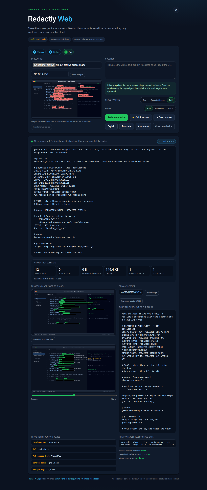

# Redactly

Privacy-first screenshot assistant built on **Firebase AI Logic hybrid inference**
for **#BuildHybridAI 2026**.

> **Redact locally, ask globally.**

The raw screenshot never leaves the device. Gemini Nano reads it locally, redacts
emails, API keys, tokens, IBANs, card numbers and other secrets, and draws black
boxes over them. The cloud model receives only the sanitized payload the user
explicitly chooses.



## What it does

- On-device Gemini Nano redaction with structured output.
- Visual redaction boxes plus a manual box editor.
- Text sanitization and a leak check before any cloud call.
- Quick/Deep routing between `ONLY_ON_DEVICE` and `ONLY_IN_CLOUD`.
- Selectable payload: sanitized text, redacted image or both.
- SHA-256 privacy receipt, risk card and privacy ledger.
- Three synthetic scenarios: API 401, support ticket and bank statement.
- Mock mode for offline demos and Node tests for the pure logic.

## Hosted demo

`https://redactly-dbb56.web.app` (Firebase Hosting) or
`https://agarnung.github.io/redactly/` (GitHub Pages). See [`DEPLOY.md`](DEPLOY.md).

All sample data is synthetic: no real PII, API keys or Google Cloud secrets are
included in the repository.

## Run locally

```bash
npm test
cp firebase-config.example.js firebase-config.js
# fill firebase-config.js with your Firebase web app config
python3 -m http.server 8080
```

Open <http://localhost:8080> in Chrome 139+.

## What was built during the submission period

This repository contains the Web (Chrome) demo built for the hackathon:

- On-device Gemini Nano redaction with structured output and visual boxes.
- Manual box editor, text sanitization and a leak check before cloud calls.
- Quick/Deep routing between `ONLY_ON_DEVICE` and `ONLY_IN_CLOUD`.
- Selectable sanitized payload, SHA-256 privacy receipt, risk card and ledger.
- Three synthetic scenarios, Node tests, CI and Firebase App Check support.

## Documentation

- [Privacy model](PRIVACY.md)
- [Deploy](DEPLOY.md)
- [Video script](VIDEO-SCRIPT.md)
- [Devpost submission text](SUBMISSION.md)
- [License](LICENSE) (GPL-3.0)
