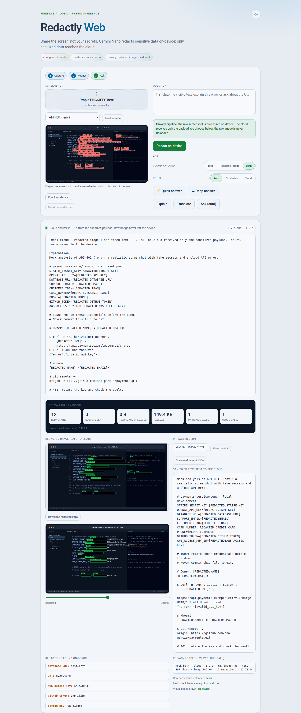

# Redactly

Privacy-first screenshot assistant built on **Firebase AI Logic hybrid inference**
for **#BuildHybridAI 2026**.

> **Redact locally, ask globally.**

The raw screenshot never leaves the device. Gemini Nano reads it locally, redacts
emails, API keys, tokens, IBANs, card numbers and other secrets, and draws black
boxes over them. The cloud model receives only the sanitized payload the user
explicitly chooses.




## What it does

- On-device Gemini Nano redaction with structured output.
- Visual redaction boxes plus a manual box editor.
- Lightbox for the original and redacted images; the original keeps the boxes and manual box editor.
- Markdown answers rendered safely instead of raw markdown in the output.
- Simple toggle between the redacted image and the original.
- Text sanitization and a leak check before any cloud call.
- Quick/Deep routing between `ONLY_ON_DEVICE` and `ONLY_IN_CLOUD`.
- Selectable payload: sanitized text, redacted image or both.
- SHA-256 privacy receipt, risk card and privacy ledger.
- Three synthetic scenarios: API 401, support ticket and bank statement.
- Mock mode for offline demos and Node tests for the pure logic.
- Bundled samples use their synthetic ground-truth boxes when the model omits them.
- Cloud image payloads are blocked when no redaction boxes were drawn.
- Drag-and-drop PNG/JPEG input with a styled picker.
- Concise tooltips on every action button.
- Light/dark theme toggle in the header, persisted in `localStorage`.

## Hosted demo

`https://redactly-dbb56.web.app` (Firebase Hosting; demo principal desplegada).
See [`DEPLOY.md`](DEPLOY.md).

All sample data is synthetic: no real PII, API keys or Google Cloud secrets are
included in the repository.

## Test it

### Mock mode (no Firebase project)

```bash
npm test
./scripts/serve.sh
```

Open the printed URL, choose a sample, click **Redact on-device**, choose a
payload and click **Quick answer** or **Deep answer**. Mock mode needs no network,
no Firebase project and no real secrets. This is the fastest way to review the flow.

### Real on-device mode (Chrome 139+)

1. Enable **On-device AI** in `chrome://settings/ai`.
2. Enable `chrome://flags/#prompt-api-for-gemini-nano-multimodal-input` and restart Chrome.
3. In DevTools → Console run `await LanguageModel.availability()`; if it returns
   `downloadable`, run `await LanguageModel.create()` and wait for the model.
4. Copy `firebase-config.example.js` to `firebase-config.js` and fill in your
   Firebase web app config. This file is gitignored; never commit it.
5. Create a **reCAPTCHA Enterprise** key for `localhost` and the hosting domain,
   then set `recaptchaSiteKey` and `appCheckProvider: "enterprise"`.
6. For local App Check, register the debug token in Firebase Console or use a fixed
   UUID in `appCheckDebugToken`. Keep `appCheckDebugToken: false` for the hosted
   reCAPTCHA demo.
7. `./scripts/serve.sh`, open the printed URL and click **Redact on-device**.
   The on-device badge checks Gemini Nano automatically; click it to recheck.
8. In DevTools → Network, Firebase calls must carry `X-Firebase-AppCheck`. The raw
   screenshot must never be uploaded.

The server script picks the next free port from `8093`, runs in the background and
writes `.run/server.pid` + `.run/server.log`. Stop it with `./scripts/stop.sh`.

### Troubleshooting

- `on-device: unavailable` → check `chrome://settings/ai`, the Prompt API flag and
  the model download in `chrome://components`.
- App Check 403 → check the site key, allowed domains and debug token.
- Port busy → the script automatically picks the next free port.

No production API keys, live Google Cloud secrets or real PII are included in the
repository or the testing instructions.

## What was built during the submission period

This is a new repository; the web app does not use pre-existing code. It contains
the Web (Chrome) demo built for the hackathon:

- On-device Gemini Nano redaction with structured output and visual boxes.
- Manual box editor, text sanitization and a leak check before cloud calls.
- Quick/Deep routing between `ONLY_ON_DEVICE` and `ONLY_IN_CLOUD`.
- Selectable sanitized payload, SHA-256 privacy receipt, risk card and ledger.
- Three synthetic scenarios, Node tests, CI and Firebase App Check support.

## Documentation

- [Project history (Spanish)](HISTORIAL.md): complete log from the initial idea
  and Firebase setup to the real Gemini Nano/App Check tests, including decisions,
  incidents and pending work.
- [Privacy model](PRIVACY.md)
- [Deploy](DEPLOY.md)
- [Video script](VIDEO-SCRIPT.md)
- [Devpost submission text](SUBMISSION.md)
- [License](LICENSE) (GPL-3.0)
